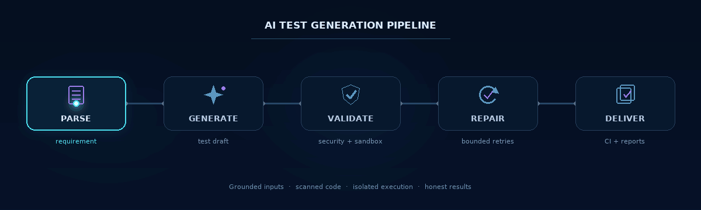
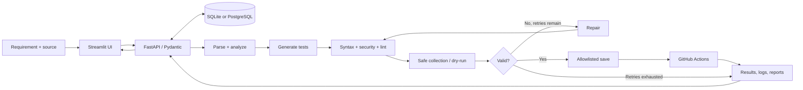
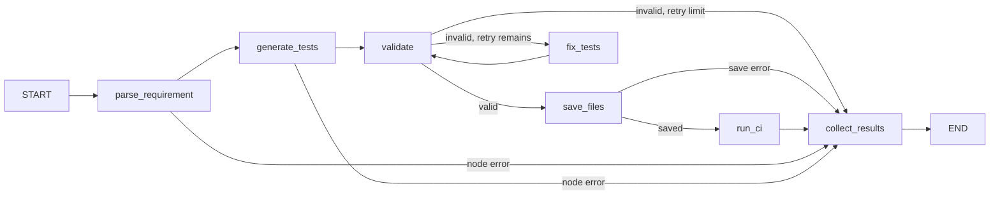

<div align="center">
<h1>AI-Powered Test Case Generator</h1>
<p><strong>From natural-language requirements to secure, reviewable unit tests.</strong></p>
<p>প্রাকৃতিক ভাষার requirement থেকে নিরাপদ, যাচাইকৃত unit test—একটি end-to-end workflow-এ।</p>

<p>
  <a href="https://www.python.org/"></a>
  <a href="https://fastapi.tiangolo.com/"></a>
  <a href="https://www.langchain.com/langgraph"></a>
  <a href="LICENSE"></a>
</p>
</div>

> **Honest execution status:** If Docker, Fargate, or another real test runtime is unavailable, the result says **Validated; sandbox not run** or **Not Run**—never **Pass**. Java syntax-shape checks are not a substitute for running JUnit.

<div align="center">
  
</div>

## Contents

- [Overview](#overview)
- [Capabilities](#capabilities)
- [Architecture](#architecture)
- [Quick start](#quick-start)
- [Configuration](#configuration)
- [API](#api)
- [Security and execution model](#security-and-execution-model)
- [GitHub automation](#github-automation)
- [AWS deployment](#aws-deployment)
- [Tests and quality checks](#tests-and-quality-checks)
- [Limitations](#limitations)
- [License](#license)

## Overview

AI-Powered Test Case Generator is an MVP for turning a requirement and optional source code into tests that can be reviewed, validated, and delivered. It combines a **Streamlit** interface, **FastAPI** service, **Pydantic v2** schemas, **LangGraph** workflow, and **SQLAlchemy** run history.

The default `local-synthesizer` works without credentials or external model calls. Configure OpenAI, Anthropic, or an Ollama-compatible endpoint for broader semantic generation and repair.

## Capabilities

| Area | What it does |
|---|---|
| **Generate** | Parse requirements and source analysis; generate Python (`pytest` / `unittest`), JavaScript (`Jest`), or Java (`JUnit 5`) tests. |
| **Validate** | Check syntax, scan for risky operations, format/lint, collect tests where a sandbox is available, and distinguish static validation from execution. |
| **Repair** | Use a bounded LangGraph retry loop; keep per-stage history, code snapshots, errors, and diffs. |
| **Edit and re-check** | Edit generated tests in the UI, revalidate them, and commit only after syntax/security checks. |
| **Deliver** | Save tests through an allowlisted path; optionally create a GitHub branch/PR and collect Actions results. |
| **Review** | Browse run history and feedback; view per-test results and download Markdown, PDF, or ZIP reports. |
| **Automate** | Start runs from signed GitHub push webhooks or an optional weekly EventBridge schedule. |

## Architecture



### LangGraph retry flow



### Repository layout

```text
.
├── app/
│   ├── main.py                         FastAPI app, request IDs, Mangum entrypoint
│   ├── automation.py                   Weekly EventBridge regression handler
│   ├── api/                            Routes, auth, webhooks, exports, Pydantic v2 schemas
│   ├── agent/
│   │   ├── graph.py                    LangGraph state machine and event streaming
│   │   ├── state.py                    Typed workflow state
│   │   ├── llm.py / prompts.py          Provider factory and grounded prompts
│   │   └── nodes/                      Parse, generate, validate, repair, save, CI, results
│   ├── core/                            Settings and structured JSON logging
│   ├── db/                              SQLAlchemy models, sessions, and persistence
│   └── tools/                           Analyzer, security, sandbox, GitHub, S3, reports
├── ui/streamlit_app.py                  Editor, progress, results, history, and exports
├── sandbox/                             Python, JavaScript, and Fargate runner images
├── deploy/                              AWS SAM template, Lambda image, and build scripts
├── .github/workflows/                   Test CI, signed webhook caller, and deployment
├── tests/                               API, graph, generation, security, and tool tests
├── docs/assets/                         README hero illustration and animated workflow
├── .env.example
├── requirements.txt
└── requirements-lambda.txt
```

## Quick start

### Prerequisites

- Python 3.11+
- Docker Engine for isolated local test collection and Python dry-runs
- Git for local branch/commit integration
- Node.js 20+ only if you explicitly use the local JavaScript subprocess runner

### Install

```bash
python -m venv .venv
source .venv/bin/activate              # Windows: .venv\Scripts\activate
python -m pip install --upgrade pip
pip install -r requirements.txt
cp .env.example .env
```

The default configuration uses SQLite, the offline synthesizer, and Docker mode. Build the sandbox images from the repository root:

```bash
docker build -f sandbox/Dockerfile -t ai-test-sandbox:latest .
# Optional: build this image when using the JavaScript sandbox.
docker build -f sandbox/Dockerfile.javascript -t ai-test-sandbox-js:latest .
```

### Run the API and UI

Start the API in one terminal:

```bash
uvicorn app.main:app --host 0.0.0.0 --port 8000 --reload
```

Start Streamlit in a second terminal:

```bash
streamlit run ui/streamlit_app.py --server.address 0.0.0.0 --server.port 8501
```

Open **http://localhost:8501**. The UI calls the API server-side; set `BACKEND_URL` in `.env` if the API is hosted elsewhere. Interactive API docs are at **http://localhost:8000/docs**.

> **First-run safety:** Turn off “Save tests and create a Git branch/commit” to avoid an automatic Git commit. Generation still saves its test file inside the configured allowlist. Set `GIT_REPO_PATH` to the target checkout before enabling local commits; if blank, the application repository is the Git target. If Docker is unavailable, static checks can still complete, but execution is reported as skipped. Do not use `SANDBOX_MODE=subprocess` for untrusted generated code.

## Configuration

All settings are read from environment variables and `.env`; see [`.env.example`](.env.example). Keep secrets on the backend—never commit `.env` or place provider keys in browser-facing code.

| Setting | Purpose |
|---|---|
| `LLM_PROVIDER` / `LLM_MODEL` | `local-synthesizer` (offline), `openai`, `anthropic`, or `ollama`. |
| `OPENAI_API_KEY` / `ANTHROPIC_API_KEY` | Provider credentials; not required for the local synthesizer. |
| `OLLAMA_BASE_URL` | Ollama-compatible endpoint; in AWS it must be reachable from the Lambda VPC. |
| `DATABASE_URL` | SQLite by default; supports PostgreSQL via `postgresql+psycopg2://...`. |
| `SANDBOX_MODE` | `docker` by default; `subprocess` is an explicit trusted-development-only fallback. |
| `API_KEY` | Optional API-key auth for protected routes; production deployments should set it. |
| `GITHUB_WEBHOOK_SECRET` | HMAC secret for GitHub push webhook verification; use a unique production secret. |
| `GIT_REPO_PATH` | Local target checkout for allowlisted test saves and branch commits. |
| `ALLOWED_TEST_DIR` | Local test path allowlist; default is `tests/generated`. Java uses `src/test/java`. |
| `GITHUB_TOKEN` | Optional GitHub Contents/PR/Actions integration, according to enabled operations. |
| `BACKEND_URL` | API origin used by the Streamlit server; defaults to `http://127.0.0.1:8000`. |
| `CORS_ORIGINS` | Comma-separated browser origins; set the exact UI origin in production. |
| `GIT_ISOLATED_WORKSPACE` | Optional local-only Git mirror for test commits; use it when you want branch history separate from the app checkout. |
| `ARTIFACT_BUCKET` / `ECS_*` | Optional durable S3 artifacts and Fargate runner configuration for Lambda. |

The API enforces a maximum requirement length of 20,000 characters and source-code length of 100,000 characters. Framework/language pairings are validated in the request schema.

## API

`/health` is public. Protected routes require `X-API-Key` when `API_KEY` is configured; `/webhook/github` is authenticated separately with `X-Hub-Signature-256` HMAC-SHA256.

| Method | Endpoint | Description |
|---|---|---|
| `GET` | `/health` | Public health status for API Gateway, CI, and container checks. |
| `POST` | `/generate` | Start a generation run; returns a `run_id`. |
| `GET` | `/status/{run_id}` | Poll stage, progress, partial outputs, and history. |
| `GET` | `/result/{run_id}` | Retrieve generated code, validation, CI, logs, and per-test results. |
| `GET` | `/history?limit=50&offset=0` | List recent generation runs. |
| `POST` | `/revalidate/{run_id}` | Revalidate edited code. |
| `POST` | `/commit/{run_id}` | Recheck and save/commit code; Lambda requires a GitHub destination. |
| `POST` | `/feedback/{run_id}` | Store a 1–5 rating and optional feedback. |
| `POST` | `/comment/{run_id}` | Post a run summary to a configured GitHub PR. |
| `POST` | `/webhook/github` | Verify a signed push event and enqueue regression runs. |
| `GET` | `/download/{run_id}/report.md` | Download a Markdown report. |
| `GET` | `/download/{run_id}/report.pdf` | Download a PDF report. |
| `GET` | `/download/{run_id}/bundle.zip` | Download test code, metadata, and reports. |
| `GET` | `/docs` | OpenAPI / Swagger UI. |

Example request (remove the `X-API-Key` header if API auth is disabled):

```bash
curl -sS -X POST http://127.0.0.1:8000/generate \
  -H 'Content-Type: application/json' \
  -H 'X-API-Key: your-local-api-key' \
  -d '{
    "requirement": "add(a, b) returns the sum of two integers.",
    "source_code": "def add(a: int, b: int) -> int:\n    return a + b\n",
    "module_name": "calculator",
    "language": "python",
    "framework": "pytest",
    "options": {
      "model": "local-synthesizer",
      "max_retries": 2,
      "coverage_target": 85,
      "include_edge_cases": true,
      "include_negative_tests": true,
      "run_sandbox_dry_run": true,
      "auto_commit": false,
      "trigger_ci": false
    }
  }'
```
Poll the returned `run_id` at `/status/{run_id}`, then fetch `/result/{run_id}`.

## How the agent works

1. **Parse and analyze.** Python uses AST analysis; JavaScript and Java use conservative source analyzers. Analysis is passed as grounding context, so targets are tied to supplied code facts.
2. **Generate.** A configured LangChain chat model is used when available. Missing credentials or an explicit offline selection use the deterministic local synthesizer.
3. **Validate before loading code.** Syntax and security checks run before collection or execution; Python formatting/linting is followed by a second safety scan.
4. **Repair within a limit.** Invalid tests can cycle through a bounded LangGraph repair loop, preserving iteration snapshots and unified diffs.
5. **Save and collect CI.** Files are written only to the configured test allowlist. Local commits use `ai-tests/<run_id>` branches; GitHub integration can create remote branches and optional PRs.
6. **Aggregate results.** Per-test results, collection/runtime execution status, coverage where available, history, logs, and reports are returned to the UI.

## Security and execution model

- **Static scan first:** the policy scanner blocks common process, network, dynamic execution, traversal, and unsafe filesystem patterns. This is defense-in-depth, not a replacement for runtime isolation.
- **Python on Docker:** generated code runs in a non-root container with networking disabled, read-only source/workspace mounts, resource limits, and a restricted temporary directory.
- **JavaScript:** the optional Docker image uses a limited Jest-compatible harness and container restrictions. Use the Actions/Jest workflow for full Jest features.
- **Java:** local validation checks syntax shape and discovery only. Real JUnit execution requires a Maven/Gradle project and is delegated to the GitHub Actions job. The reference Fargate runner executes Python/pytest only.
- **AWS Lambda:** Lambda does not run Docker. When configured, it dispatches Python execution to an ephemeral Fargate task with no task IAM role; the runner gets short-lived, single-object S3 URLs and runs tests as an unprivileged UID. Its egress is restricted to S3, private ECR/CloudWatch Logs endpoints, and VPC DNS.
- **File writes:** paths are resolved and checked beneath an allowlisted directory. Absolute paths and `..` traversal are rejected. Java test files preserve the source package beneath `src/test/java/`.
- **No false pass:** when collection or execution did not occur, reports say so. A skipped sandbox run is not reported as a passing test suite.
- **Secrets and auth:** `.env` is ignored by Git; API-key comparison is constant-time; webhook signatures are HMAC verified. Limit GitHub token permissions and review generated code before merging.

## GitHub automation

- [`run_generated_tests.yml`](.github/workflows/run_generated_tests.yml) runs Python, JavaScript, and configured Maven/Gradle tests for generated-test branches/PRs and uploads JUnit/coverage artifacts.
- [`generate_on_commit.yml`](.github/workflows/generate_on_commit.yml) signs push payloads and calls `/webhook/github`. Configure repository secrets `GENERATOR_API_URL` (API base URL) and `GENERATOR_WEBHOOK_SECRET` (same value as backend `GITHUB_WEBHOOK_SECRET`).
- [`deploy.yml`](.github/workflows/deploy.yml) uses GitHub OIDC for tag-triggered SAM deployments; it does not require a long-lived AWS access key.

For GitHub commits/PRs, configure `GITHUB_TOKEN` and the target repo. Grant only the permissions needed: repository contents write and pull-request write for commits/PRs; Actions read for workflow polling. Lambda manual commits require both a repo and GitHub token; Lambda cannot commit into its read-only function package.

## AWS deployment

[`deploy/template.yaml`](deploy/template.yaml) provisions API Gateway, a Lambda container, private PostgreSQL RDS, encrypted S3 artifacts, ECS/Fargate, an S3 Gateway endpoint, private ECR and CloudWatch Logs interface endpoints, scoped security groups, alarms, and an optional weekly EventBridge schedule. The Streamlit UI is deployed separately and points to the `ApiBaseUrl` output.

### Prerequisites

1. AWS account, AWS CLI, Docker, and AWS SAM CLI.
2. VPC with private subnets and private route tables. Lambda needs NAT egress for external LLM/GitHub APIs; the Fargate task has no general internet route.
3. Regional AWS-managed S3 prefix-list ID for the `S3PrefixListId` parameter. The stack creates the Gateway endpoint and private interface endpoints for ECR and CloudWatch Logs.
4. Secrets Manager secrets: API key JSON such as `{"api_key":"..."}` (required), optional LLM JSON keys (`openai_api_key`, `anthropic_api_key`), and optional GitHub JSON keys (`github_token`, `webhook_secret`).

Build and push the Fargate runner image:

```bash
export AWS_REGION=us-east-1
./deploy/build_sandbox_image.sh
```

Build and deploy:

```bash
sam build --template-file deploy/template.yaml
sam deploy --guided --template-file .aws-sam/build/template.yaml
```

Supply `VpcId`, `VpcCidr`, `PrivateSubnetIds`, `PrivateRouteTableIds`, `S3PrefixListId`, `SandboxImageUri`, and `ApiKeySecretArn`. `LLMSecretArn` and `GitHubSecretArn` are optional. Set Streamlit `BACKEND_URL` to the `ApiBaseUrl` stack output and set its `API_KEY` environment variable to the same value stored in the API-key secret.

To enable weekly regression runs, provide `RegressionRepo`, `RegressionBranch`, and `RegressionModulesJson` (a JSON array of up to five source paths). The default schedule is Sunday at 02:00 UTC. The reference handler runs modules sequentially; use a durable queue for larger workloads.

### Deployment workflow variables/secrets

`.github/workflows/deploy.yml` uses GitHub OIDC, not a long-lived AWS access key. Configure:

- Secret `AWS_DEPLOY_ROLE_ARN` with an OIDC-trusted deploy role.
- Secrets `API_KEY_SECRET_ARN` (required), plus optional `LLM_SECRET_ARN` and `GITHUB_SECRET_ARN`.
- Variables `AWS_REGION`, `SAM_STACK_NAME`, `VPC_ID`, `VPC_CIDR`, `PRIVATE_SUBNET_IDS`, `PRIVATE_ROUTE_TABLE_IDS`, and `S3_PREFIX_LIST_ID`.
- Optional variables `REGRESSION_REPO`, `REGRESSION_BRANCH`, `REGRESSION_MODULES_JSON`, `LLM_PROVIDER`, `LLM_MODEL`, `OLLAMA_BASE_URL`, and `CORS_ORIGINS`. If using Ollama, set a URL reachable from Lambda.

### AWS cost planning (indicative, not a quote)

Actual charges depend on region, DB sizing, NAT traffic, Lambda duration, model tokens, and Fargate frequency. Check AWS Pricing Calculator before deploying.

- **RDS PostgreSQL (`db.t4g.micro`, single AZ):** roughly USD 12–25/month plus storage/backups, depending on region; typically the largest always-on cost.
- **NAT Gateway:** roughly USD 30–45/month per gateway before data processing; reuse an existing NAT where possible.
- **VPC interface endpoints:** ECR API, ECR Docker, and CloudWatch Logs endpoints are billed per AZ plus data processing, in addition to NAT.
- **Lambda + API Gateway:** often low single-digit dollars/month for light test traffic; generation duration and LLM tokens can dominate.
- **Fargate sandbox:** billed per task vCPU/memory-second; a 0.5 vCPU / 1 GB task running for about one minute is usually a few cents or less, depending on region and architecture.
- **S3 / CloudWatch / EventBridge:** generally low at demo volume. The template expires artifacts after 90 days and retains sandbox/API logs for 14/30 days.
- **LLM usage:** provider/model-specific and potentially the largest variable cost; set provider budgets and rate limits.

These are planning ranges, not a quote; verify current regional prices before provisioning. For a low-cost demo, use local SQLite and the local synthesizer, and avoid creating RDS/NAT until needed. RDS snapshot retention and deletion protection require an intentional teardown.

## Tests and quality checks

```bash
pytest -q
ruff check app ui tests sandbox
black --check app ui tests sandbox
```

For the AWS template, optionally run `cfn-lint deploy/template.yaml` and `sam validate --template-file deploy/template.yaml` when those tools are installed.

The suite covers analysis and requirement parsing, deterministic generation, security/sandbox behavior, API routes/auth, LangGraph orchestration, Git path protection, webhook verification, GitHub/CI parsing, and Markdown/PDF/ZIP exports.

## Limitations

- FastAPI `BackgroundTasks` is suitable for a small deployment, not a durable production queue. Use SQS, Celery, or Step Functions for reliable larger workloads.
- The runner receives one source file and does not clone arbitrary repositories or install their complete dependency trees. Include relevant dependencies or extend the worker for multi-file projects.
- The local synthesizer is deliberately conservative and cannot replace a code-capable LLM for broad semantic requirements; it avoids inventing expected results when no contract is provided.
- Java local checks do not execute JUnit; the configured Maven/Gradle CI job is needed for real Java test results.
- The JavaScript sandbox implements a Jest subset; use full Jest in GitHub Actions for broader Jest functionality and coverage.
- The UI polls the API rather than using WebSockets; `stream_agent_events()` is available for a future streaming transport.

## License

Distributed under the [MIT License](LICENSE).
