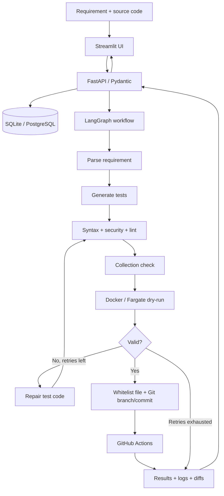
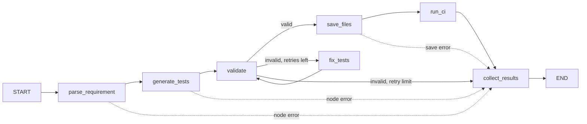

# AI-Powered Test Case Generator

প্রাকৃতিক ভাষার requirement ও ঐচ্ছিক source code থেকে unit test তৈরি, static/security validation, সীমিত retry/fix loop, sandbox execution, Git branch/PR এবং CI result একত্র করে দেখানোর জন্য একটি কার্যকর MVP। UI হলো Streamlit, API FastAPI, workflow LangGraph, local persistence SQLite (AWS-তে PostgreSQL), এবং sandbox mode Docker বা AWS ECS Fargate।

> **সত্যনিষ্ঠ ফলাফল:** sandbox/runtime না চললে UI “Validated; sandbox not run” দেখায়—এটিকে test pass বলা হয় না। Java-র JUnit execution-এর জন্য প্রকৃত Maven/Gradle project প্রয়োজন; API শুধু syntax-shape/discovery check করতে পারে, GitHub Actions-এ configured Maven/Gradle থাকলে আসল JUnit run হয়।

## Architecture



### LangGraph workflow diagram



### Repository layout

```text
app/
  main.py                      FastAPI, request-ID middleware, Mangum/EventBridge entrypoint
  automation.py                Weekly EventBridge regression generation
  api/routes.py                API routes, auth, webhook, exports and background tasks
  api/schemas.py               Pydantic v2 request/response and validation models
  agent/graph.py               LangGraph state machine and event streaming
  agent/state.py               Typed workflow state
  agent/llm.py                 OpenAI / Anthropic / Ollama / local provider factory
  agent/prompts.py             Grounded prompts and language/framework examples
  agent/nodes/                 Parse, generate, validate, repair, save, CI, collect nodes
  core/                        Settings and structured JSON logging
  db/                          SQLAlchemy models, SQLite/PostgreSQL sessions and CRUD
  tools/                       AST analysis, security/lint, sandbox, GitHub, S3, reports
ui/streamlit_app.py            Streamlit UI with editor, progress, logs, history and exports
sandbox/                        Python, Node.js and Fargate sandbox images/runners
.github/workflows/              Generated-test CI, commit webhook and tag deployment
deploy/template.yaml            SAM: API Gateway, Lambda, RDS, S3, ECS/Fargate, alarms, schedule
```

## Quick start (local development)

### 1. Requirements

- Python 3.11+
- Docker Engine (recommended/required for isolated local dry-runs)
- Node.js 20+ only if explicitly enabling local JavaScript sandbox mode
- Git for local branches/commits

### 2. Install

```bash
python -m venv .venv
source .venv/bin/activate              # Windows: .venv\Scripts\activate
python -m pip install --upgrade pip
pip install -r requirements.txt
cp .env.example .env
```

The default provider is `local-synthesizer`; it makes no network/API calls. The local synthesizer is conservative and creates smoke tests from source signatures. For deeper semantic test design and automatic repairs, configure an LLM provider and credentials in the backend `.env` (do not put secrets in Git or the UI).

Example `.env` settings:

```dotenv
LLM_PROVIDER=local-synthesizer
# Or LLM_PROVIDER=openai and set OPENAI_API_KEY
# Or LLM_PROVIDER=anthropic and set ANTHROPIC_API_KEY
# Or LLM_PROVIDER=ollama with OLLAMA_BASE_URL=http://localhost:11434

DATABASE_URL=sqlite:///./ai_test_gen.db
SANDBOX_MODE=docker
SANDBOX_DOCKER_IMAGE=ai-test-sandbox:latest
SANDBOX_DOCKER_IMAGE_JS=ai-test-sandbox-js:latest
API_KEY=
```

Build sandbox images from the repository root:

```bash
docker build -f sandbox/Dockerfile -t ai-test-sandbox:latest .
docker build -f sandbox/Dockerfile.javascript -t ai-test-sandbox-js:latest .
```

Start the API and UI in two terminals:

```bash
uvicorn app.main:app --host 0.0.0.0 --port 8000 --reload
```

```bash
streamlit run ui/streamlit_app.py --server.address 0.0.0.0 --server.port 8501
```

Open `http://localhost:8501`. Set `BACKEND_URL` in `.env` if the API is not at `http://127.0.0.1:8000`. The Streamlit server makes API calls server-side; it does not expose a browser-side `localhost` fetch.

> If Docker is not available, static validation and code delivery still work; status will say that sandbox execution was skipped. For trusted local experimentation only, `SANDBOX_MODE=subprocess` enables a host subprocess fallback. **Do not use that fallback for generated or untrusted code in production.**

## API

Interactive docs: `GET /docs`. `GET /health` is unauthenticated. When `API_KEY` is set, send it as `X-API-Key` for normal API routes. GitHub webhook authentication uses `X-Hub-Signature-256` HMAC-SHA256 instead.

| Method | Endpoint | Purpose |
|---|---|---|
| `POST` | `/generate` | Start an asynchronous generation run; returns `run_id` |
| `GET` | `/status/{run_id}` | Stage, progress, partial output, and history for polling |
| `GET` | `/result/{run_id}` | UI-ready test code, validation, per-test markers, logs, history |
| `GET` | `/history?limit=50&offset=0` | Recent runs |
| `POST` | `/revalidate/{run_id}` | Re-validate edited UI code |
| `POST` | `/commit/{run_id}` | Security/syntax-check, save and create a local Git commit |
| `POST` | `/webhook/github` | Verify push-event HMAC and enqueue regression generation |
| `POST` | `/feedback/{run_id}` | Store 1–5 rating and user feedback |
| `POST` | `/comment/{run_id}` | Post a run summary to a GitHub PR |
| `GET` | `/download/{run_id}/report.md` | Markdown report |
| `GET` | `/download/{run_id}/report.pdf` | PDF report |
| `GET` | `/download/{run_id}/bundle.zip` | Test code, metadata and reports |
| `GET` | `/health` | Health/readiness check |

Example request:

```bash
curl -sS -X POST http://127.0.0.1:8000/generate \
  -H 'Content-Type: application/json' \
  -H 'X-API-Key: your-local-api-key' \
  -d '{
    "requirement": "add(a, b) returns the sum of two integers.",
    "source_code": "def add(a: int, b: int) -> int:\n    return a + b\n",
    "module_name": "calculator",
    "language": "python",
    "framework": "pytest",
    "options": {
      "model": "local-synthesizer",
      "max_retries": 2,
      "coverage_target": 85,
      "include_edge_cases": true,
      "include_negative_tests": true,
      "run_sandbox_dry_run": true,
      "auto_commit": false,
      "trigger_ci": false
    }
  }'
```

Poll the returned `run_id` at `/status/{run_id}`, then retrieve `/result/{run_id}`. API request and source-code limits are enforced by Pydantic schemas.

## Agent behavior

1. **Parsing:** `app/tools/code_analyzer.py` uses Python AST or conservative JavaScript/Java parsers to extract symbols, signatures, docstrings, imports, branches and raised exceptions. When source is present, implementation targets are grounded in those facts. The parser returns assumptions for ambiguous or requirement-only runs.
2. **Generation:** the LangChain model is selected through environment settings. The local synthesizer needs no API key. LLM prompts request deterministic, framework-idiomatic tests and forbid network/system calls.
3. **Validation:** Python AST/`py_compile`, JavaScript `node --check`, Java syntax-shape checks, security scan, formatter/linter, test collection, then dry-run. The report separates errors from warnings and reports whether collection/runtime actually executed.
4. **Repair loop:** failing code and structured error reports are sent back to the configured LLM. The graph stops at `max_retries`, records correction snapshots and unified diffs, and never silently treats a no-op repair as a fix.
5. **Saving:** Python and JavaScript tests are constrained to `tests/generated/`; Java tests are written under `src/test/java/` with the source package path preserved. Existing files are backed up before replacement. Local Git commits use `ai-tests/<run_id>` branches. With `GITHUB_TOKEN` and a repo configured, the GitHub API can create a remote branch, commit and optional PR. In Lambda, code/artifacts are persisted to S3 and the GitHub API is used instead of a read-only local checkout.
6. **CI/results:** Actions workflow runs pytest/Jest/JUnit where configured, uploads JUnit/coverage XML, and the API parses summaries. UI displays ✅ / ❌ markers, duration, coverage, logs, fixes, PR link and report downloads.

## Security model

- **Code is scanned before collection or execution.** The AST/regex guard rejects process/shell execution, `eval`/`exec`, raw sockets, direct network calls, dynamic imports, unsafe OS calls, path traversal and filesystem operations that are not rooted in temporary fixtures.
- **Local Python sandbox:** Docker uses `--network none`, a read-only source/workspace mount, non-root UID, read-only root filesystem, bounded CPU/memory/PIDs, and a small `/tmp` tmpfs. The Docker image is deliberately small.
- **Local JavaScript sandbox:** the Node image uses the same network/resource/read-only/non-root restrictions and a limited Jest-compatible harness. Production CI uses Jest itself.
- **AWS Lambda:** Lambda does not run Docker. The optional ECS Fargate runner executes Python tests in a disposable task. The task has no task IAM role, receives one-run S3 presigned URLs, has no inbound rules, and can reach S3 plus the private ECR/CloudWatch Logs endpoints and VPC DNS only; it has no general internet route. The runner starts as a supervisor, then executes tests as an unprivileged UID distinct from the process holding the presigned URLs. Build/deploy `sandbox/Dockerfile.ecs` to use this path.
- **GitHub webhook:** HMAC signature verification uses constant-time comparison. An empty webhook secret rejects all pushes.
- **File writes:** paths are resolved and checked under the configured test whitelist; absolute paths and `..` traversal are rejected.
- **Secrets:** `.env` is ignored by Git. AWS deployment uses Secrets Manager dynamic references; Lambda IAM does not receive the LLM/GitHub secret values via a runtime Secrets Manager read permission. Fargate tasks receive no API or GitHub token.
- **API auth/logging:** optional API-key auth, CORS configuration, request-ID middleware and structured JSON logs. Restrict `CORS_ORIGINS` to trusted UI origins in production.
- Do not grant the GitHub token more access than necessary. For remote test commits/PRs, grant repository contents and pull-request access only; for polling workflows, include Actions read access.

## GitHub Actions and webhooks

`.github/workflows/run_generated_tests.yml` runs on pushes to `ai-tests/**`, PRs, and manual dispatch. It runs Python tests with JUnit/coverage, Jest tests, and Maven/Gradle JUnit when a build file exists. The `generate_on_commit.yml` workflow signs push payloads with `GENERATOR_WEBHOOK_SECRET` and calls `/webhook/github`; configure repository secrets:

- `GENERATOR_API_URL` — API base URL, without `/webhook/github`.
- `GENERATOR_WEBHOOK_SECRET` — exactly the same value as backend `GITHUB_WEBHOOK_SECRET`.

The webhook accepts only signed push events, ignores test/vendor paths, fetches changed supported source files via GitHub Contents API, and creates a limited number of generation runs.

## AWS SAM deployment

`deploy/template.yaml` provisions API Gateway, a Lambda container, private PostgreSQL RDS, encrypted S3 artifacts, ECS Fargate task definition/cluster, an S3 Gateway endpoint, private ECR and CloudWatch Logs interface endpoints, scoped security groups, CloudWatch log groups/alarms, and an optional weekly EventBridge rule. The Lambda and database must be placed in an existing VPC with private subnets. Lambda needs NAT egress for external LLM/GitHub APIs; the sandbox Fargate task can access only the S3, ECR, and CloudWatch Logs endpoints plus VPC DNS, with no general internet route.

### Required AWS setup

1. Create/use a VPC with private subnets, private route tables, VPC DNS support, and a NAT Gateway route for Lambda egress. The stack creates private ECR and CloudWatch Logs interface endpoints for Fargate image pulls and logs.
2. Find the regional AWS-managed S3 prefix list ID (the `S3PrefixListId` parameter). The stack creates an S3 Gateway endpoint on the supplied private route tables, scoped to generated artifacts and ECR image-layer downloads.
3. Create three Secrets Manager secrets:
   - API key secret JSON, e.g. `{"api_key":"a-long-random-value"}`.
   - LLM secret JSON, e.g. `{"openai_api_key":"...","anthropic_api_key":""}` (optional if using the local provider).
   - GitHub secret JSON, e.g. `{"github_token":"...","webhook_secret":"..."}` (optional if no GitHub integration is needed).
4. Push the Fargate runner image and note its URI:

```bash
export AWS_REGION=us-east-1
./deploy/build_sandbox_image.sh
```

5. Build/deploy SAM (or create a `v*` tag to use `.github/workflows/deploy.yml`):

```bash
sam build --template-file deploy/template.yaml
sam deploy --guided --template-file .aws-sam/build/template.yaml
```

Provide `VpcId`, `VpcCidr`, `PrivateSubnetIds`, `PrivateRouteTableIds`, `S3PrefixListId`, `SandboxImageUri`, and `ApiKeySecretArn`. `LLMSecretArn` and `GitHubSecretArn` are optional. Output `ApiBaseUrl` becomes the Streamlit `BACKEND_URL`; store the same API key in Streamlit's backend environment.

To enable weekly regression generation, also provide `RegressionRepo`, `RegressionBranch`, and `RegressionModulesJson`, e.g. `["src/calculator.py","src/validators.py"]` (valid JSON array). The default schedule is Sunday 02:00 UTC. The EventBridge handler runs up to five modules sequentially; use SQS/Celery for larger workloads.

### Deployment workflow variables/secrets

`.github/workflows/deploy.yml` uses GitHub OIDC (no long-lived AWS access key in GitHub). Configure:

- Secret: `AWS_DEPLOY_ROLE_ARN` with an OIDC-trusted deploy role.
- Secrets: `API_KEY_SECRET_ARN`, optionally `LLM_SECRET_ARN`, `GITHUB_SECRET_ARN`.
- Variables: `AWS_REGION`, `SAM_STACK_NAME`, `VPC_ID`, `VPC_CIDR`, `PRIVATE_SUBNET_IDS`, `PRIVATE_ROUTE_TABLE_IDS`, `S3_PREFIX_LIST_ID`, and optional `REGRESSION_REPO`, `REGRESSION_BRANCH`, `REGRESSION_MODULES_JSON`, `LLM_PROVIDER`, `LLM_MODEL`, `OLLAMA_BASE_URL`, `CORS_ORIGINS`. Set `OLLAMA_BASE_URL` to an endpoint reachable from Lambda when `LLM_PROVIDER=ollama`.

### AWS cost planning (indicative, not a quote)

Actual price depends on region, DB sizing, NAT traffic, Lambda duration, model tokens, and Fargate frequency. Validate with AWS Pricing Calculator before deployment.

- **RDS PostgreSQL (`db.t4g.micro`, single AZ):** typically the largest always-on cost; plan roughly USD 12–25/month plus storage/backups, depending on region.
- **NAT Gateway:** often roughly USD 30–45/month per gateway before data processing charges; this can exceed Lambda cost for a small demo. Reuse a NAT already in the VPC where possible.
- **VPC interface endpoints:** ECR API, ECR Docker, and CloudWatch Logs endpoints are billed per AZ plus data processing; account for this private-egress cost in addition to NAT.
- **Lambda + API Gateway:** usually low single-digit dollars/month for light test traffic; generation duration and external LLM token use dominate.
- **Fargate sandbox:** billed per task vCPU/memory second; a 0.5 vCPU / 1 GB task running for about one minute is usually a few cents or less, depending on region and architecture.
- **S3 / CloudWatch / EventBridge:** generally low at demo volume; set lifecycle/retention (the template expires artifacts after 90 days and logs after 14–30 days).
- **LLM usage:** provider/model-specific and potentially the largest variable cost; set provider budgets and rate limits.

These estimates are planning ranges only; check live regional prices before provisioning. For a low-cost demo, use local SQLite and the local synthesizer, and avoid creating RDS/NAT until needed.

## Tests and code quality

```bash
pytest -q
ruff check app ui tests sandbox
black --check app ui tests sandbox
```

Tests cover analyzer behavior, five requirement samples, security policies, Docker/local sandbox runner contracts, JavaScript harness, Git path protection/commits, HMAC/JUnit/report parsing, LangGraph orchestration, and API endpoints/authentication.

## Limitations and production notes

- `BackgroundTasks` is appropriate for a single-process demo; it is not a durable job queue. For production, replace it with SQS/Celery/Step Functions and a worker service. Lambda request/background work is still bounded by its invocation timeout.
- Local mode only knows the provided requirement/source. Include dependent modules and runtime requirements when testing a multi-file project; the sandbox mounts the supplied source file and does not clone or install an arbitrary repository's full dependency tree.
- The deterministic local synthesizer is conservative; it does not replace a code-capable LLM for broad semantic specifications. It avoids inventing expected results where no contract is provided.
- Java gets syntax-shape/discovery checks locally. Actual JUnit execution is delegated to a configured Maven/Gradle GitHub Actions workflow; the Fargate reference image is for Python/pytest.
- The built-in JavaScript runner implements a documented Jest subset; use GitHub Actions/Jest for full Jest features and coverage.
- GitHub workflow polling requires a pushed branch and an appropriately scoped token. If no remote repository/token is configured, output is kept locally (or in S3 on Lambda), and local dry-run results remain authoritative.
- UI uses polling rather than WebSockets. `stream_agent_events()` is available to integrate with a streaming transport.
- AWS deployment creates billable RDS/VPC resources. Remove the stack intentionally after review; the RDS snapshot deletion policy and deletion protection require an explicit safe teardown.
